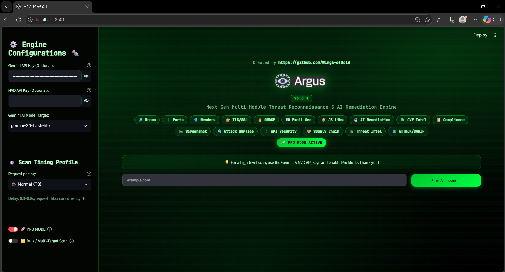
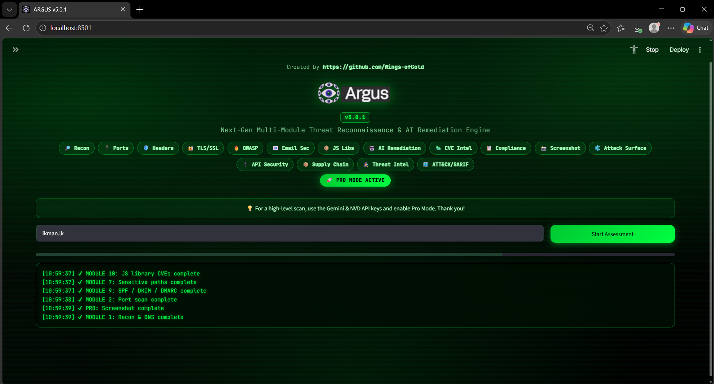

<div align="center">


### Next-Gen Multi-Module Threat Reconnaissance & AI Remediation Engine


**Created by [Wings-ofGold](https://github.com/Wings-ofGold)**

</div>

---

## ⚠️ Legal Disclaimer

ARGUS performs **active** security checks (port scanning, sensitive-path probing, API probing).
**Only scan systems you own or have explicit written permission to test.**
Unauthorized scanning may be illegal in your country. The author accepts no liability for misuse or damage caused by this tool.

---

## 📸 Screenshots

| Dashboard |
|:---:|
|  |

| Scan Results | PDF Report |
|:---:|:---:|
|  |  |

> The images above are placeholders. Replace the files in the `assets/` folder with your own screenshots (keep the same file names).

---

## ✨ Features

### Core modules
| # | Module | What it does |
|---|--------|--------------|
| 1 | Recon & Discovery | IP resolution, DNS records (A / AAAA / MX / NS / TXT), redirect chain, `robots.txt`, `sitemap.xml`, WAF and tech-stack detection |
| 2 | Open Port Scanner | Common-port scan with a risk level and potential threat for every open port |
| 3 | Security Headers Audit | HSTS, CSP and other important response headers |
| 4 | TLS / SSL Analysis | Certificate validity, expiry, issuer, protocol version, cipher |
| 5 | Cookie Security | `Secure` / `HttpOnly` flag audit |
| 6 | HTTP Security Inspection | Status and response inspection |
| 7 | Misconfiguration Checks | Exposed sensitive files (`/.env`, `/.git/HEAD`, `/phpinfo.php`, ...) with SPA catch-all detection to reduce false positives |
| 8 | OWASP Top 10 Assessment | Automated mapping of findings to OWASP Top 10 categories |
| 9 | Email Security | SPF, DMARC and best-effort DKIM checks |
| 10 | JS Library Scan | Detects front-end libraries and checks versions against live [OSV.dev](https://osv.dev) data |

### 🚀 Pro Mode modules
| # | Module | What it does |
|---|--------|--------------|
| 11 | CVE Cross-Reference | Looks up CVEs for the detected tech stack via the NIST NVD API |
| 12 | Compliance Mapping | Maps findings to PCI-DSS, ISO 27001 and GDPR |
| 13 | Visual Recon | Website screenshot capture |
| 14 | Attack Surface Expansion | Passive subdomain discovery (certificate transparency) and public cloud-bucket exposure checks |
| 15 | API & Modern App Security | API/GraphQL endpoint discovery, introspection check, CORS and JWT-shape checks |
| 16 | Supply Chain | SBOM generation and secrets-in-JavaScript detection |
| 17 | Threat Intel | Breach-exposure check link (Have I Been Pwned domain search) |
| 18 | Reporting / Interop | MITRE ATT&CK mapping and SARIF export |

### Extras
- 🤖 **AI remediation guide**: step-by-step fixes generated with Google Gemini (optional, needs a free API key)
- 🗂️ **Bulk scan**: up to 12 targets, shown on a 4-per-screen live monitoring wall
- ⏱️ **Timing profiles** (nmap-style `T0` to `T5`): control request pacing, jitter, concurrency and automatic back-off on `429` / `403`
- ⚡ **Parallel scan engine**: independent modules run concurrently for much faster scans
- 📄 **Exports**: PDF assessment report, JSON telemetry, SBOM (JSON), SARIF
- 🖤 Black & hacker-green UI

---

## 📦 Requirements

- **Python 3.10 or newer**
- **Git** (only if you clone the repository)
- Internet access (several modules query public services)

Python packages (installed automatically from `requirements.txt`):
`streamlit`, `pandas`, `dnspython`, `plotly`, `reportlab`, `requests`, `google-generativeai`, `Pillow`

---

## 🚀 Installation & Run

### 🪟 Windows (PowerShell or CMD)

1. Install [Python 3.10+](https://www.python.org/downloads/) (tick **"Add Python to PATH"** during setup) and [Git](https://git-scm.com/download/win).
2. Open a terminal and run:

```powershell
git clone https://github.com/Wings-ofGold/ARGUS.git
cd ARGUS

python -m venv venv
venv\Scripts\activate

python -m pip install --upgrade pip
pip install -r requirements.txt

streamlit run app.py
```

> **PowerShell says "running scripts is disabled"?** Run this once in the same window, then activate again:
> `Set-ExecutionPolicy -Scope Process -ExecutionPolicy Bypass`
> (or just use **CMD** instead of PowerShell).

### 🐧 Linux (Debian / Ubuntu / Kali) and macOS

```bash
# Debian / Ubuntu / Kali only (macOS: install Python with Homebrew instead)
sudo apt update && sudo apt install -y python3 python3-venv python3-pip git

git clone https://github.com/Wings-ofGold/ARGUS.git
cd ARGUS

python3 -m venv venv
source venv/bin/activate

pip install --upgrade pip
pip install -r requirements.txt

streamlit run app.py
```

> Using a virtual environment (`venv`) avoids the `externally-managed-environment` error on newer Debian, Ubuntu and Kali systems.

### Open the dashboard

Streamlit opens your browser automatically. If it does not, go to:

**http://localhost:8501**

To use a different port: `streamlit run app.py --server.port 8502`

### Run it again later

```bash
cd ARGUS
venv\Scripts\activate          # Windows
source venv/bin/activate       # Linux / macOS
streamlit run app.py
```

---

## 🔑 API Keys (optional)

Both keys are optional and are entered in the dashboard sidebar. They are **not saved to disk** by ARGUS.

| Key | Used for | Where to get it |
|-----|----------|-----------------|
| Gemini API Key | AI remediation guide | [Google AI Studio](https://aistudio.google.com/app/apikey) (free tier available) |
| NVD API Key | Higher rate limit for CVE lookups (Pro Mode) | [NVD API key request](https://nvd.nist.gov/developers/request-an-api-key) |

> Copy the key carefully. Spaces, line breaks or non-English symbols in the key will make the Gemini request fail.

---

## 🧭 How to use

1. Start the app and enter a target domain or URL (for example `example.com`) in the main box.
2. Pick a **Scan Timing Profile** in the sidebar (slower profiles are quieter and less likely to be rate-limited; faster profiles finish sooner).
3. Choose the modules you want under **Active Modules**.
4. Turn on **🚀 PRO MODE** for the extended modules and **Bulk / Multi-Target Scan** for several targets (one domain per line, max 12).
5. Click **Start Assessment** and watch the live terminal.
6. Review the result tabs, then download the PDF report, JSON telemetry, SBOM or SARIF file.

### Timing profiles

| Profile | Delay per request | Concurrency |
|---------|------------------|-------------|
| 🐢 Paranoid (T0) | 8 - 15 s | 2 |
| 🐌 Sneaky (T1) | 3 - 6 s | 3 |
| 🚶 Polite (T2) | 1 - 2.5 s | 5 |
| ⚖️ Normal (T3) *(default)* | 0.3 - 0.8 s | 10 |
| 🏃 Aggressive (T4) | 0 - 0.2 s | 15 |
| ⚡ Insane (T5) | none | 25 |

---

## 🔒 Privacy note

Some modules send the **target domain** to public third-party services: OSV.dev (JS library vulnerabilities), NVD (CVEs), crt.sh (subdomains), and thum.io (screenshots). If you provide a Gemini API key, the **scan results** are sent to Google's Gemini API to generate the remediation guide. Leave the related modules or key disabled if that is not acceptable for your target.

---

## 📁 Project structure

```
ARGUS/
├── app.py                  # Main Streamlit application
├── requirements.txt        # Python dependencies
├── README.md
├── LICENSE
├── .gitignore
├── .streamlit/
│   └── config.toml         # Black & green theme
└── assets/
    ├── logo.png
    └── screenshot-*.png
```

> `config.toml` must live inside the `.streamlit` folder. If it sits next to `app.py`, Streamlit ignores it.

---

## 🛠️ Troubleshooting

| Problem | Fix |
|---------|-----|
| `streamlit` is not recognized | Activate the virtual environment first, or run `python -m streamlit run app.py` |
| `ModuleNotFoundError` | Make sure the venv is active, then run `pip install -r requirements.txt` again |
| `width="stretch"` / unexpected keyword error | Your Streamlit is too old: `pip install -U streamlit` |
| Port 8501 already in use | `streamlit run app.py --server.port 8502` |
| Gemini section shows an error | Re-copy the API key (no spaces or line breaks) and check your internet connection |
| NVD tab is empty or slow | Add an NVD API key, or wait a moment (public rate limit is 5 requests / 30 s) |
| Slow scan | Use a faster timing profile (T3 to T5); stealth profiles are slow on purpose |

---

## 📝 Changelog

### v5.0.1
- Renamed to **ARGUS** with a new logo and a black & hacker-green interface
- Parallel scan engine: independent modules run at the same time
- Removed the HIBP API key option (breach check now links to the manual lookup)
- Fixed Streamlit `use_container_width` deprecation warnings
- Fixed Gemini API key handling

---

## 👤 Author

**Wings-ofGold** - [github.com/Wings-ofGold](https://github.com/Wings-ofGold)

## 📜 License

Released under the [MIT License](LICENSE).
