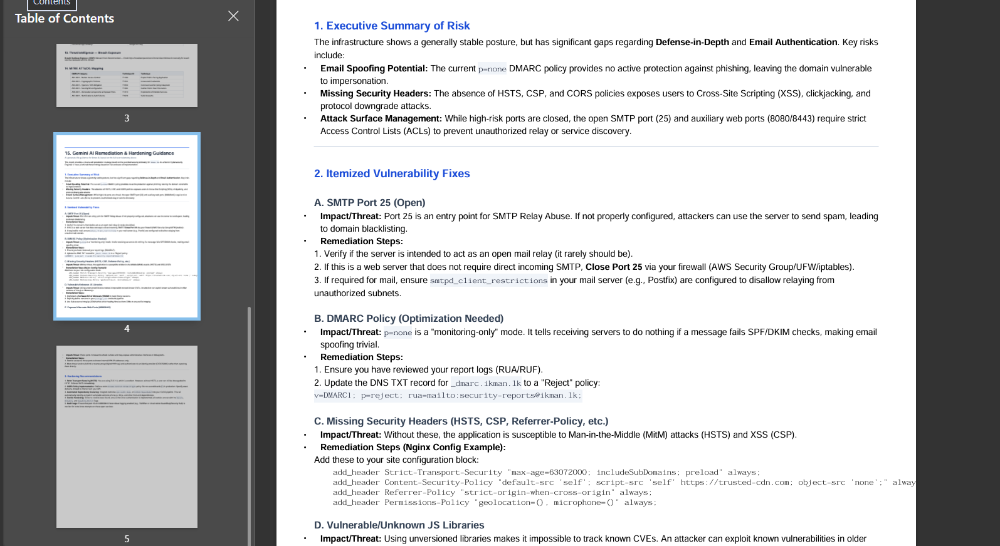

<div align="center">


### Next-Gen Multi-Module Threat Reconnaissance & AI Remediation Engine


**Created by [Wings-ofGold](https://github.com/Wings-ofGold)**

</div>

---

## ⚠️ Legal Disclaimer

ARGUS performs **active** security checks (port scanning, banner grabbing, sensitive-path probing, HTTP method and redirect probing, API probing).
**Only scan systems you own or have explicit written permission to test.**
Unauthorized scanning may be illegal in your country. The author accepts no liability for misuse or damage caused by this tool.

---

## 📸 Screenshots

| Dashboard |
|:---:|
|  |

| Scan Results | PDF Report |
|:---:|:---:|
|  |  |

---

## ✨ Features

### Core modules (always available)
| # | Module | What it does |
|---|--------|--------------|
| 1 | Recon & Discovery | IP resolution, DNS records (A / AAAA / MX / NS / TXT), redirect chain, `robots.txt`, `sitemap.xml`, WAF and tech-stack detection |
| 2 | Open Port Scanner | Common-port scan with a risk level and potential threat per open port, plus **banner grabbing and service/version detection** (HTTP, DNS, MySQL and other banners) |
| 3 | Security Headers Audit | HSTS, CSP and other important response headers |
| 4 | TLS / SSL Analysis | Certificate validity, expiry, issuer, hostname match, negotiated cipher, and per-version protocol support (TLS 1.0 to 1.3) |
| 5 | Cookie Security | `Secure` / `HttpOnly` / `SameSite` audit |
| 6 | HTTP Security Inspection | Status and response inspection |
| 7 | Misconfiguration Checks | Exposed sensitive files (`/.env`, `/.git/HEAD`, `/phpinfo.php`, ...) with SPA catch-all detection to reduce false positives |
| 8 | OWASP Top 10 Assessment | Automated mapping of findings to OWASP Top 10 categories |
| 9 | Email Security | SPF, DMARC and best-effort DKIM checks |
| 10 | JS Library Scan | Detects front-end libraries and checks versions against live [OSV.dev](https://osv.dev) data (offline fallback list if OSV is unreachable) |
| 11 | Subresource Integrity (SRI) | Checks external scripts and stylesheets for `integrity` attributes |
| 12 | HTTP Methods & Redirect Analysis | `TRACE` / `DELETE` / `PUT` exposure, HTTP to HTTPS redirect chain, and open-redirect parameter probing |

> **Safety note for module 12:** `PUT` is only read from the `Allow` header, `DELETE` is only sent to a random non-existent path, and the open-redirect check uses a reserved `example.org` canary host. ARGUS never writes to the target.

### 🚀 Pro Mode modules
| # | Module | What it does |
|---|--------|--------------|
| 13 | CVE Cross-Reference | Looks up CVEs through the NIST NVD API using the detected tech stack **and** service versions found by the port scan |
| 14 | Compliance Mapping | Maps findings to PCI-DSS, ISO 27001 and GDPR |
| 15 | Visual Recon | Website screenshot capture |
| 16 | Attack Surface Expansion | Passive subdomain discovery (certificate transparency), public cloud-bucket exposure checks, and subdomain-takeover fingerprinting (detection only) |
| 17 | API & Modern App Security | API/GraphQL endpoint discovery, introspection check, CORS and JWT-shape checks |
| 18 | Supply Chain | SBOM generation and secrets-in-JavaScript detection |
| 19 | Threat Intel | Breach-exposure check link (Have I Been Pwned domain search) |
| 20 | Reporting / Interop | MITRE ATT&CK mapping and SARIF export |

### Extras
- 🤖 **AI remediation guide**: step-by-step fixes generated with Google Gemini (optional, needs a free API key). Model selectable in the sidebar: `gemini-3.1-flash-lite` or `gemini-3.5-flash`
- 🗂️ **Bulk scan** (Pro Mode): up to 12 targets per run, shown on a 4-per-screen monitoring wall with a full drill-down report per target
- ⏱️ **Timing profiles** (nmap-style `T0` to `T5`): control request pacing, jitter, concurrency and automatic back-off on `429` / `403`
- ⚡ **Parallel scan engine**: independent modules run concurrently inside each scan
- 📄 **Exports**: PDF assessment report, JSON telemetry, SBOM (JSON), SARIF
- 🖤 Black & hacker-green UI

---

## 📦 Requirements

- **Python 3.10 or newer**
- Internet access (several modules query public services)
- **Git** is optional. You can download a ZIP instead (see Option B below)

Python packages (installed from `requirements.txt`):

| Package | Minimum | Why |
|---------|---------|-----|
| `streamlit` | **1.51** | The UI uses `width="stretch"` on charts, tables and buttons |
| `pandas` | **2.1** | Table styling uses `Styler.map` |
| `dnspython` | any recent | DNS lookups and banner queries |
| `plotly` | any recent | Charts |
| `reportlab` | any recent | PDF report |
| `requests` | any recent | HTTP probing |
| `google-generativeai` | any recent | AI remediation guide |
| `Pillow` | any recent | Logo / icon handling |

Suggested `requirements.txt`:

```text
streamlit>=1.51
pandas>=2.1
dnspython
plotly
reportlab
requests
google-generativeai
Pillow
```

---

## 🚀 Installation & Run

Pick **one** of the options below. Option B needs no Git and no GitHub account.

### Option A: Git clone

```bash
git clone https://github.com/Wings-ofGold/ARGUSv5.0.1.git
cd ARGUSv5.0.1
```

> **Git asks for a username and password?** The repository is public, so no login is needed. See [Troubleshooting](#-troubleshooting) below.

### Option B: Download ZIP (no Git needed)

1. Open **https://github.com/Wings-ofGold/ARGUSv5.0.1**
2. Click the green **Code** button, then **Download ZIP**
3. Extract it and open a terminal inside the extracted folder (the one that contains `app.py`)

### Then set up Python

#### 🪟 Windows (PowerShell or CMD)

Install [Python 3.10+](https://www.python.org/downloads/) and tick **"Add Python to PATH"** during setup.

```powershell
python -m venv venv
venv\Scripts\activate

python -m pip install --upgrade pip
pip install -r requirements.txt

python -m streamlit run app.py
```

> If `python` is not found, try `py` instead of `python`.
> **PowerShell says "running scripts is disabled"?** Run this once in the same window, then activate again:
> `Set-ExecutionPolicy -Scope Process -ExecutionPolicy Bypass`
> (or just use **CMD** instead of PowerShell).

#### 🐧 Linux (Debian / Ubuntu / Kali) and 🍎 macOS

```bash
# Debian / Ubuntu / Kali only (macOS: install Python with Homebrew instead)
sudo apt update && sudo apt install -y python3 python3-venv python3-pip

python3 -m venv venv
source venv/bin/activate

pip install --upgrade pip
pip install -r requirements.txt

python -m streamlit run app.py
```

> Using a virtual environment (`venv`) avoids the `externally-managed-environment` error on newer Debian, Ubuntu and Kali systems.

#### 🐳 Docker (any OS)

Create a file named `Dockerfile` next to `app.py`:

```dockerfile
FROM python:3.12-slim
WORKDIR /app
COPY requirements.txt .
RUN pip install --no-cache-dir -r requirements.txt
COPY . .
EXPOSE 8501
CMD ["streamlit", "run", "app.py", "--server.address=0.0.0.0", "--server.port=8501"]
```

```bash
docker build -t argus .
docker run --rm -p 8501:8501 argus
```

### Open the dashboard

Streamlit opens your browser automatically. If it does not, go to:

**http://localhost:8501**

To use a different port: `python -m streamlit run app.py --server.port 8502`

### Run it again later

```bash
cd ARGUSv5.0.1
venv\Scripts\activate          # Windows
source venv/bin/activate       # Linux / macOS
python -m streamlit run app.py
```

### Update to a newer version

```bash
cd ARGUSv5.0.1
git pull
pip install -r requirements.txt --upgrade
```

(If you used the ZIP option, download the new ZIP and replace the folder.)

---

## 🔑 API Keys (optional)

Both keys are optional and are entered in the dashboard sidebar. They are **not saved to disk** by ARGUS.

| Key | Used for | Where to get it |
|-----|----------|-----------------|
| Gemini API Key | AI remediation guide | [Google AI Studio](https://aistudio.google.com/app/apikey) (free tier available) |
| NVD API Key | Raises the NVD rate limit from 5 to 50 requests / 30 s (Pro Mode CVE lookup) | [NVD API key request](https://nvd.nist.gov/developers/request-an-api-key) |

> Copy the key carefully. Spaces, line breaks or non-English symbols in the key will make the Gemini request fail.

---

## 🧭 How to use

1. Start the app and enter a target domain or URL (for example `example.com`) in the main box.
2. Pick a **Scan Timing Profile** in the sidebar (slower profiles are quieter and less likely to be rate-limited; faster profiles finish sooner).
3. Choose the modules you want under **Active Modules**.
4. Turn on **🚀 PRO MODE** for modules 13 to 20 and **🗂️ Bulk / Multi-Target Scan** for several targets (one domain per line, max 12).
5. Click **Start Assessment** (or **Start Bulk Assessment**) and watch the live terminal.
6. Review the result tabs, then download the PDF report, JSON telemetry, SBOM or SARIF file.

> 💡 For the most complete scan, add both the Gemini and NVD API keys and enable Pro Mode.

### Timing profiles

| Profile | Delay per request | Concurrency |
|---------|------------------|-------------|
| 🐢 Paranoid (T0) | 8 - 15 s | 2 |
| 🐌 Sneaky (T1) | 3 - 6 s | 3 |
| 🚶 Polite (T2) | 1 - 2.5 s | 5 |
| ⚖️ Normal (T3) *(default)* | 0.3 - 0.8 s | 10 |
| 🏃 Aggressive (T4) | 0 - 0.2 s | 15 |
| ⚡ Insane (T5) | none | 25 |

Profiles T0 to T2 keep probes against the target sequential and back off automatically when the target answers `429` or `403`, so a blocked scan is less likely to be misread as "no firewall detected".

---

## 🔒 Privacy note

Some modules send the **target domain** (or, for the port scan, direct connections) to third parties or to the target itself:

- **OSV.dev**: JS library vulnerability lookups
- **NVD**: CVE lookups
- **crt.sh**: subdomain discovery
- **thum.io**: website screenshots
- **The target itself**: port scan, banner grabbing, path and method probing
- **Google Gemini**: if you provide a Gemini API key, the **scan results** are sent to Google's Gemini API to generate the remediation guide

The Have I Been Pwned check is only a link for manual lookup; no request is sent. Leave the related modules or key disabled if any of this is not acceptable for your target.

---

## 📁 Project structure

```
ARGUSv5.0.1/
├── app.py                  # Main Streamlit application
├── requirements.txt        # Python dependencies
├── Dockerfile              # Optional, for Docker users
├── README.md
├── LICENSE
├── .gitignore
├── .streamlit/
│   └── config.toml         # Black & green theme
└── assets/
    ├── logo.png
    └── screenshot-*.png
```

> `config.toml` must live inside the `.streamlit` folder. If it sits next to `app.py`, Streamlit ignores it.

---

## 🛠️ Troubleshooting

| Problem | Fix |
|---------|-----|
| **`git clone` asks for a Username / Password** | GitHub asks for a login whenever it cannot find a public repository at that URL. Check that the URL is exactly `https://github.com/Wings-ofGold/ARGUSv5.0.1.git` and that the repository is public. You never need your own GitHub password for ARGUS. Press `Ctrl+C`, then use the **Download ZIP** option instead. Note that GitHub no longer accepts account passwords for Git over HTTPS in any case |
| `streamlit` is not recognized | Activate the virtual environment first, or run `python -m streamlit run app.py` |
| `ModuleNotFoundError` | Make sure the venv is active, then run `pip install -r requirements.txt` again |
| `width="stretch"` / unexpected keyword error | Your Streamlit is too old: `pip install -U "streamlit>=1.51"` |
| `AttributeError: 'Styler' object has no attribute 'map'` | Your pandas is too old: `pip install -U "pandas>=2.1"` |
| `externally-managed-environment` | Use a virtual environment (`python3 -m venv venv`) as shown above |
| Port 8501 already in use | `python -m streamlit run app.py --server.port 8502` |
| Gemini section shows an error | Re-copy the API key (no spaces or line breaks) and check your internet connection |
| NVD tab is empty or slow | Add an NVD API key, or wait a moment (public rate limit is 5 requests / 30 s) |
| Screenshot or subdomain results are empty | Those modules rely on thum.io and crt.sh; check your internet connection or try again later |
| Slow scan | Use a faster timing profile (T3 to T5); stealth profiles are slow on purpose |

---

## 📝 Changelog

### v5.1.0
- New module **Subresource Integrity (SRI) check**
- New module **HTTP Methods & Redirect Analysis** (TRACE / DELETE / PUT exposure, redirect chain, open-redirect probing)
- Port scanner now performs **banner grabbing and service/version detection**; detected versions feed the NVD CVE lookup and the OWASP assessment
- Attack Surface module now includes **subdomain-takeover fingerprinting** (detection only)
- Module set expanded to **20 modules** (12 core + 8 Pro)
- Streamlit width API migration: **Streamlit 1.51+ and pandas 2.1+ are now required**
- NVD API key now documented as raising the limit from 5 to 50 requests / 30 s
- README: added ZIP and Docker install options and a fix for the clone credential prompt

### v5.0.1
- Renamed to **ARGUS** with a new logo and a black & hacker-green interface
- Parallel scan engine: independent modules run at the same time
- Removed the HIBP API key option (breach check now links to the manual lookup)
- Fixed Streamlit `use_container_width` deprecation warnings
- Fixed Gemini API key handling

---

## 👤 Author

**Wings-ofGold** - [github.com/Wings-ofGold](https://github.com/Wings-ofGold)

## 📜 License

Released under the [MIT License](LICENSE).
